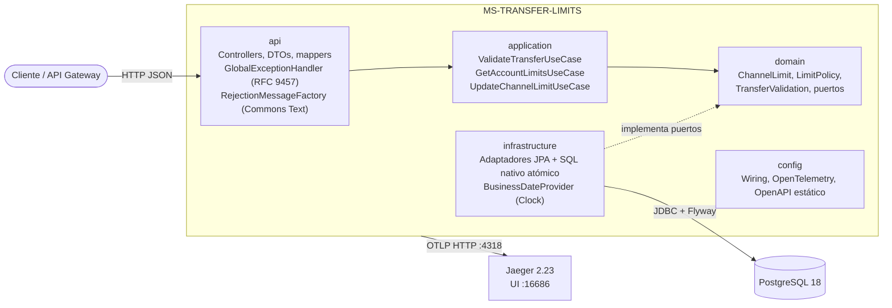
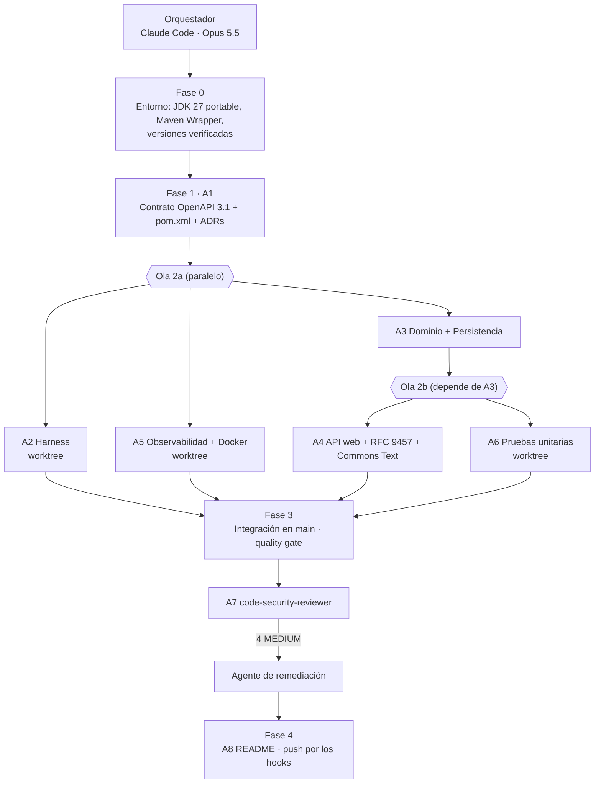

# MS-TRANSFER-LIMITS • Banamex

[](https://spring.io/projects/spring-boot)
[-orange.svg)](https://adoptium.net/)
[-C71A36.svg)](.mvn/wrapper/maven-wrapper.properties)
[](https://www.postgresql.org/)
[](src/main/resources/openapi/openapi.yaml)
[](https://google.github.io/styleguide/javaguide.html)
[](pom.xml)
[](compose.yaml)
[](https://edgar-ia-expert.web.app/Banamex_Caso_Practico.html)

Microservicio financiero para **Banamex** que decide en tiempo real si una transferencia puede
realizarse según los límites del cliente **por canal**, registra el consumo del límite diario en la
misma transacción y rechaza (RFC 9457) cualquier operación que lo exceda, garantizando que ni
siquiera bajo concurrencia (*race conditions*) el consumo supere el límite.

> 🌐 **Demo Interactiva y Documentación Ejecutiva en Vivo:**  
> Puedes probar la simulación completa de negocio y consultar el dossier de arquitectura y nivel directivo aquí:  
> 👉 **[https://edgar-ia-expert.web.app/Banamex_Caso_Practico.html](https://edgar-ia-expert.web.app/Banamex_Caso_Practico.html)**  
> **Banco:** Banamex | **Cliente Titular:** Edgar Rosas Aamaro | **Cuenta:** `8840-3101`

---

## 📋 Tabla de Contenido
1. [Descripción del Negocio](#-descripción-del-negocio)
2. [Arquitectura y Stack Tecnológico](#-arquitectura-y-stack-tecnológico)
3. [Endpoints del Contrato OpenAPI 3.1](#-endpoints-del-contrato-openapi-31)
4. [Pasos para Ejecutar el Proyecto](#-pasos-para-ejecutar-el-proyecto)
5. [Agente Utilizado](#-agente-utilizado)
6. [Estrategia Paso a Paso](#-estrategia-paso-a-paso)
7. [Harness del Agente: CLAUDE.md, Settings, Skills, Subagente y Hooks](#-harness-del-agente-claudemd-settings-skills-subagente-y-hooks)
8. [Manejo de Concurrencia](#-manejo-de-concurrencia)
9. [Errores Estándar RFC 9457 y Mensajes con Apache Commons Text](#-errores-estándar-rfc-9457-y-mensajes-con-apache-commons-text)
10. [Trazabilidad Distribuida (OpenTelemetry)](#-trazabilidad-distribuida-opentelemetry)
11. [Cobertura de Pruebas (JaCoCo ≥ 90 %)](#-cobertura-de-pruebas-jacoco--90-)
12. [Exclusiones y Limitaciones Conocidas](#-exclusiones-y-limitaciones-conocidas)
13. [Estructura del Repositorio](#-estructura-del-repositorio)

---

## 🏦 Descripción del Negocio

* **Límites por canal:** cada cuenta tiene, para cada canal (`MOBILE_APP`, `WEB`, `BRANCH`):
  * **Límite por operación:** monto máximo de una sola transferencia.
  * **Límite diario:** monto total que la cuenta puede transferir en el día de negocio.
* **Criterio de aprobación:**
  $$\text{Aprobada} \iff (\text{monto} \le \text{límite por operación}) \land (\text{consumido hoy} + \text{monto} \le \text{límite diario})$$
* **Registro atómico:** al aprobarse, el monto se suma al consumo del día en la misma transacción.
* **Dinero:** `BigDecimal` con escala 2, moneda `MXN`, `NUMERIC(19,2)` en base de datos; monto > 0.
* **Día de negocio:** fecha en la zona `America/Mexico_City` (configurable con
  `transfer-limits.business-zone`), obtenida siempre de un `Clock` inyectado.
* **Idempotencia por `transferId` (UUID):** repetir el mismo `transferId` con el mismo payload
  devuelve el resultado original sin volver a consumir; con payload distinto → `409 TRANSFER_ID_CONFLICT`.
* **Configuración de límites:** `perOperationLimit ≤ dailyLimit`, si no → `422 INVALID_LIMIT_CONFIGURATION`.

---

## 🛠 Arquitectura y Stack Tecnológico

Arquitectura **hexagonal ligera** (ADR-001) bajo el paquete base `com.banamex.transferlimits`.
Regla de dependencias: `api → application → domain ← infrastructure`; el dominio no importa Spring,
JPA, Jackson ni servlets.



| Componente | Versión / detalle |
| :--- | :--- |
| Lenguaje | **Java 27** (Eclipse Temurin 27.0.1) |
| Framework | **Spring Boot 4.2.0** (`spring-boot-starter-webmvc`, validation, data-jpa, flyway, actuator, opentelemetry) |
| Build | **Maven 3.9.16** vía Maven Wrapper (`./mvnw`, `mvnw.cmd`) — nunca un `mvn` global |
| Persistencia | **PostgreSQL 18** (`postgres:18-alpine` en compose) + Spring Data JPA + **Flyway** (`ddl-auto=validate`) |
| Contrato | **OpenAPI 3.1 contract-first** en `src/main/resources/openapi/openapi.yaml` (ADR-003) |
| Documentación API | springdoc-openapi **3.2.0**: Swagger UI en `/swagger-ui.html` (sirve `/openapi/openapi.yaml`) y `/v3/api-docs` |
| Mensajes | **Apache Commons Text 1.15.0** (`StringSubstitutor`) |
| Estilo | **google-java-format 2.0.0** vía **Spotless 3.11.0** + **Checkstyle 14.4.0** (`google_checks.xml`, las advertencias fallan) |
| Cobertura | **JaCoCo 0.8.16**, `jacoco:check` LINE y BRANCH ≥ 0.90 en `verify` |
| Observabilidad | Actuator (`health`, `info`, `metrics`) + `spring-boot-starter-opentelemetry` → OTLP → **Jaeger 2.23** |
| Pruebas | JUnit 5, Mockito, AssertJ, slices `@WebMvcTest` (sin pruebas de integración) |
| Contenedores | `Dockerfile` multi-stage (`eclipse-temurin:27-jdk` → `eclipse-temurin:27-jre`, capas de Spring Boot, usuario no root, `HEALTHCHECK`) + `compose.yaml` |

Decisiones documentadas en [`docs/adr/`](docs/adr): ADR-001 arquitectura hexagonal, ADR-002
concurrencia, ADR-003 contract-first.

---

## 📡 Endpoints del Contrato OpenAPI 3.1

| Método | Endpoint | Descripción | Códigos HTTP |
| :--- | :--- | :--- | :--- |
| **GET** | `/api/v1/accounts/{accountId}/limits` | Límites y consumo del día por canal | `200`, `400`, `404` |
| **PUT** | `/api/v1/accounts/{accountId}/limits/{channelId}` | Crea o actualiza (upsert) límite diario y por operación del canal | `200`, `400`, `409`, `422` |
| **POST** | `/api/v1/accounts/{accountId}/transfer-validations` | Valida la transferencia y consume el límite diario de forma atómica | `201` aprobada, `200` reintento idempotente, `400`, `404`, `409`, `422` rechazada |
| **GET** | `/actuator/health` | Salud del servicio (incluye la base de datos) | `200`, `503` |

`accountId` acepta `^[A-Za-z0-9-]{1,34}$`; `channelId` es `MOBILE_APP`, `WEB` o `BRANCH`. Una
prueba (`ContractConformanceTest`) compara las rutas/métodos del contrato con los endpoints
registrados, de modo que una divergencia rompe `./mvnw verify`.

---

## 🚀 Pasos para Ejecutar el Proyecto

### Requisitos previos
* **JDK 27** (Temurin 27). En Windows, por ejemplo:
  ```powershell
  winget install EclipseAdoptium.Temurin.27.JDK
  ```
  o descomprimir un JDK portable y apuntar `JAVA_HOME` a él (los scripts del harness también buscan
  un JDK portable en `%USERPROFILE%\.local\devtools\jdk\<dir>`).
* **Git** (en Windows, Git Bash para ejecutar los scripts `bash`).
* **Docker** (opcional): sólo para `docker compose` o para levantar PostgreSQL/Jaeger localmente.
* No se necesita Maven instalado: se usa el Maven Wrapper.

### 1. Clonar y activar los git hooks
```bash
git clone https://github.com/edgarcdmx/MS-TRANSFER-LIMITS.git
cd MS-TRANSFER-LIMITS
bash scripts/install-hooks.sh     # = git config core.hooksPath .githooks
```

### 2. Compilar y ejecutar el gate de calidad
```bash
./mvnw verify                     # Linux / macOS / Git Bash
.\mvnw.cmd verify                 # PowerShell / cmd
bash scripts/quality-gate.sh      # mismo gate por etapas, con pistas de corrección
```
`verify` compila, ejecuta las pruebas unitarias y aplica `spotless:check`, `checkstyle:check` y
`jacoco:check` (LINE y BRANCH ≥ 90 %). El reporte queda en `target/site/jacoco/index.html`.

### 3. Ejecutar en local con PostgreSQL
La aplicación lee la conexión de variables de entorno. **`DB_PASSWORD` no tiene valor por defecto.**

| Variable | Ejemplo |
| :--- | :--- |
| `DB_URL` | `jdbc:postgresql://localhost:5432/transfer_limits` |
| `DB_USERNAME` | `transfer` |
| `DB_PASSWORD` | *(obligatoria, sin default)* |
| `OTEL_EXPORTER_OTLP_ENDPOINT` | `http://localhost:4318` (opcional, URL **base**; Boot agrega `/v1/traces`) |

```bash
# PostgreSQL 18 y Jaeger con compose (o una instancia propia de PostgreSQL)
cp .env.example .env              # y edita las credenciales
docker compose up -d postgres jaeger

export DB_URL=jdbc:postgresql://localhost:5432/transfer_limits
export DB_USERNAME=transfer
export DB_PASSWORD='<tu-password>'
./mvnw spring-boot:run
```
Flyway crea el esquema al arrancar (`src/main/resources/db/migration/V1__init.sql`). No hay datos
semilla: primero se configura un límite con `PUT` (ver ejemplos).

### 4. Ejecutar todo con Docker Compose
```bash
cp .env.example .env              # credenciales de PostgreSQL usadas por compose
docker compose up --build
```
| Servicio | URL |
| :--- | :--- |
| API | `http://localhost:8080` |
| Swagger UI | `http://localhost:8080/swagger-ui.html` (contrato en `/openapi/openapi.yaml`, generado en `/v3/api-docs`) |
| Health | `http://localhost:8080/actuator/health` |
| Jaeger UI | `http://localhost:16686` (servicio `ms-transfer-limits`) |

En compose la app usa el perfil `docker` y `OTEL_EXPORTER_OTLP_ENDPOINT=http://jaeger:4318`.

### 5. Ejemplos `curl` (cuerpos tomados de los ejemplos de `openapi.yaml`)

**PUT — configurar límites del canal**
```bash
curl -s -X PUT http://localhost:8080/api/v1/accounts/ACC-001/limits/MOBILE_APP \
  -H 'Content-Type: application/json' \
  -d '{"dailyLimit": 50000.00, "perOperationLimit": 20000.00, "currency": "MXN"}'
```
```json
{
  "channel": "MOBILE_APP",
  "currency": "MXN",
  "dailyLimit": 50000.00,
  "perOperationLimit": 20000.00,
  "consumedToday": 0.00,
  "availableToday": 50000.00,
  "updatedAt": "2026-11-19T17:20:00Z"
}
```

**POST — transferencia aprobada (`201 Created`)**
```bash
curl -s -i -X POST http://localhost:8080/api/v1/accounts/ACC-001/transfer-validations \
  -H 'Content-Type: application/json' \
  -d '{"transferId": "3f1c2b9e-7a4d-4c1e-9b8a-2d6f5e4c3b2a", "channel": "MOBILE_APP", "amount": 1500.00, "currency": "MXN"}'
```
```json
{
  "transferId": "3f1c2b9e-7a4d-4c1e-9b8a-2d6f5e4c3b2a",
  "accountId": "ACC-001",
  "status": "APPROVED",
  "channel": "MOBILE_APP",
  "amount": 1500.00,
  "currency": "MXN",
  "dailyLimit": 50000.00,
  "perOperationLimit": 20000.00,
  "consumedToday": 1500.00,
  "availableToday": 48500.00,
  "businessDate": "2026-11-19",
  "validatedAt": "2026-11-19T17:21:30.123Z"
}
```
Repetir exactamente la misma petición devuelve `200 OK` con el mismo cuerpo y **no** vuelve a consumir.

**POST — transferencia rechazada (`422`, `application/problem+json`)**
```bash
curl -s -X POST http://localhost:8080/api/v1/accounts/ACC-001/transfer-validations \
  -H 'Content-Type: application/json' \
  -d '{"transferId": "9b2e4c7a-1d3f-4a5b-8c6d-7e8f9a0b1c2d", "channel": "MOBILE_APP", "amount": 25000.00, "currency": "MXN"}'
```
```json
{
  "type": "https://api.banamex.example/problems/per-operation-limit-exceeded",
  "title": "Límite por operación excedido",
  "status": 422,
  "detail": "El monto 25,000.00 MXN excede el límite por operación de 20,000.00 MXN para el canal MOBILE_APP.",
  "instance": "/api/v1/accounts/ACC-001/transfer-validations",
  "code": "PER_OPERATION_LIMIT_EXCEEDED",
  "traceId": "4bf92f3577b34da6a3ce929d0e0e4736",
  "transferId": "9b2e4c7a-1d3f-4a5b-8c6d-7e8f9a0b1c2d",
  "reasonCode": "PER_OPERATION_LIMIT_EXCEEDED"
}
```

**GET — límites y consumo del día**
```bash
curl -s http://localhost:8080/api/v1/accounts/ACC-001/limits
```
```json
{
  "accountId": "ACC-001",
  "businessDate": "2026-11-19",
  "channels": [
    {
      "channel": "MOBILE_APP",
      "currency": "MXN",
      "dailyLimit": 50000.00,
      "perOperationLimit": 20000.00,
      "consumedToday": 1500.00,
      "availableToday": 48500.00,
      "updatedAt": "2026-11-19T17:20:00Z"
    }
  ]
}
```

**GET — salud**
```bash
curl -s http://localhost:8080/actuator/health
```
```json
{ "status": "UP", "groups": ["liveness", "readiness"] }
```
(Los detalles de componentes como `db` sólo se muestran a usuarios autorizados: `show-details: when-authorized`.)

---

## 🤖 Agente Utilizado

Se utilizó **Claude Code (CLI)** con el modelo **Claude Opus 5.5** (`claude-opus-5-5`) como
**orquestador** de un enjambre de sub-agentes especializados. El prompt maestro se escribió
**primero, a petición del usuario**, y está versionado en
[`PROMPT_ENJAMBRE.md`](PROMPT_ENJAMBRE.md); cada agente recibió un brief autocontenido con los
archivos que le pertenecían y los que no debía tocar.

### Enjambre

| Agente | Rol | Archivos de los que es dueño | Aislamiento | Resultado |
| :--- | :--- | :--- | :--- | :--- |
| **A1** Arquitecto / Contrato | Versiones, `pom.xml`, contrato, ADRs | `pom.xml`, `openapi.yaml`, `docs/adr/`, `mvnw*`, `.mvn/` | Repo principal (Fase 1, secuencial) | Proyecto Maven + OpenAPI 3.1 + 3 ADRs (`a560df1`) |
| **A2** Harness | Guardarraíles de Claude Code y git | `CLAUDE.md`, `.claude/**`, `.githooks/**`, `scripts/**`, `config/checkstyle/` | **Worktree** | Settings, 4 skills, subagente revisor, hooks (`0b35200`) |
| **A3** Dominio + Persistencia | Dominio puro, puertos, adaptadores JPA, consumo atómico | `domain/**`, `infrastructure/**`, `db/migration/**` | Repo principal | Dominio, Flyway y `UPDATE … RETURNING` (`2824e15`) |
| **A4** API web | Controllers, casos de uso, RFC 9457, Commons Text | `api/**`, `application/**`, `messages/**` | Repo principal (ola 2b) | API conforme al contrato (`684f81d`) |
| **A5** Observabilidad + Docker | `application.yml`, OTel, contenedores | `config/**`, `application.yml`, `Dockerfile`, `compose.yaml`, `.dockerignore` | **Worktree** | OTel → Jaeger, imagen y compose (`dad6cf5`) |
| **A6** Pruebas | Pruebas unitarias y de concurrencia | `src/test/**` | **Worktree** | 241 pruebas, 100 % líneas y ramas (`07193aa`) |
| **A7** `code-security-reviewer` | Revisión de calidad y seguridad (sólo lectura) | — (sólo escribe `target/review/REVIEW_OK`) | Subagente del proyecto | **APPROVED**: 0 CRITICAL/HIGH, 4 MEDIUM |
| **Remediación** | Corrección de los hallazgos MEDIUM del revisor | Archivos afectados por cada hallazgo | Repo principal | 4 MEDIUM corregidos; LOW documentados abajo |
| **A8** Documentación | Este README | `README.md` | Repo principal | README en español |



### Servidores MCP (`.mcp.json`, sin secretos)

| MCP | Uso previsto | Qué ocurrió en la sesión |
| :--- | :--- | :--- |
| `github` | Operaciones sobre el repo `edgarcdmx/MS-TRANSFER-LIMITS` | No pudo autenticarse porque el token (`GITHUB_PERSONAL_ACCESS_TOKEN`) se creó después de iniciar la sesión. La verificación/creación del repo se hizo con la **API REST de GitHub** usando el mismo token; finalmente el usuario creó el repo manualmente porque el token *fine-grained* no tenía el permiso *Administration*. |
| `context7` | Documentación vigente de Spring Boot 4, springdoc, OTel, Commons Text | Configurado, pero **no conectó** en este entorno; la documentación se consultó con `fetch`. |
| `fetch` | Lectura de documentación y verificación de versiones | Usado por los agentes para leer la documentación de Spring Boot 4.2, la de hooks de Claude Code, los tags de Docker Hub y las versiones en Maven Central. |

El MCP `postgres` propuesto en el prompt maestro no se incluyó en `.mcp.json` (no había PostgreSQL
en la máquina).

---

## 🧭 Estrategia Paso a Paso

**Fase 0 — Entorno.** La máquina no tenía Java, Maven, `gh` ni Docker. Se instaló un **JDK 27
portable fuera del repositorio** (`%USERPROFILE%\.local\devtools\jdk`) y se adoptó el **Maven
Wrapper** (Maven 3.9.16). Las versiones se verificaron en Maven Central y Adoptium el
**2026-11-19** (Spring Boot 4.2.0, Commons Text 1.15.0, springdoc 3.2.0, Spotless 3.11.0,
Checkstyle 14.4.0, JaCoCo 0.8.16).

**Fase 1 — Contract-first (A1).** Antes de escribir Java se definió `openapi.yaml` (OpenAPI 3.1)
con esquemas, ejemplos y el catálogo de Problem Details; además `pom.xml` con todos los gates y
los ADR-001/002/003. El contrato fue la fuente de verdad compartida por los demás agentes.

**Fase 2 — Construcción en dos olas** (por dependencias de compilación):
* **Ola 2a (paralelo):** A2 harness (worktree), A3 dominio + persistencia + concurrencia,
  A5 observabilidad + Docker (worktree).
* **Ola 2b:** A4 API web + RFC 9457 + Commons Text y A6 pruebas (worktree), que necesitaban
  compilar contra el dominio y los puertos de A3.

**Fase 3 — Integración y revisión.** El orquestador integró las ramas en `main`, ejecutó el gate
(`./mvnw verify`) y lanzó el subagente `code-security-reviewer`. Veredicto **APPROVED** con
**0 CRITICAL/HIGH**; los **4 MEDIUM** los corrigió un agente de remediación y los **LOW** restantes
se documentan en [Exclusiones y Limitaciones](#-exclusiones-y-limitaciones-conocidas).

**Fase 4 — Entrega.** A8 actualizó este README y el push se hizo **pasando por los hooks** (gate +
aprobación del revisor para `HEAD`), nunca con `--no-verify`.

---

## 🛡 Harness del Agente: CLAUDE.md, Settings, Skills, Subagente y Hooks

| Pieza | Archivo | Qué hace |
| :--- | :--- | :--- |
| Instrucciones | [`CLAUDE.md`](CLAUDE.md) | Propósito, mapa hexagonal, comandos, reglas (Google Style, contract-first, `BigDecimal`, `Clock`, RFC 9457, SQL sólo con parámetros), reglas de pruebas, definición de terminado, flujo obligatorio antes de push y lista de prohibiciones. |
| Permisos | [`.claude/settings.json`](.claude/settings.json) | **allow:** `./mvnw`, `mvnw.cmd`, `scripts/quality-gate.sh`, `scripts/install-hooks.sh`, `git status/diff/log/add/commit/branch/checkout/rev-parse`, `mcp__github__*`, `mcp__context7__*`, `mcp__fetch__*`. **deny:** leer `.env*`, `git push --force`/`-f`, cualquier `--no-verify`, `rm -rf /*`. `enableAllProjectMcpServers: true`. |
| Skill | `.claude/skills/quality-gate` | Ejecutar e interpretar el gate y corregir formato, Checkstyle, pruebas y cobertura. |
| Skill | `.claude/skills/new-endpoint` | Flujo contract-first: `openapi.yaml` → DTOs → caso de uso → controller → Problem Details → pruebas → gate. |
| Skill | `.claude/skills/problem-details` | Catálogo RFC 9457 y procedimiento para agregar un código de error. |
| Skill | `.claude/skills/docker-release` | Construir la imagen, `docker compose up`, verificar health y trazas en Jaeger. |
| Subagente | [`.claude/agents/code-security-reviewer.md`](.claude/agents/code-security-reviewer.md) | Revisor de sólo lectura (Google Style, límites hexagonales, dinero, concurrencia, inyección SQL, validación, datos sensibles, OWASP API Top 10, RFC 9457, cobertura, secretos). Devuelve tabla de hallazgos y veredicto; **sólo si es APPROVED** escribe `target/review/REVIEW_OK` con el SHA de `HEAD`. |
| Hook git nativo | [`.githooks/pre-push`](.githooks/pre-push) | Ejecuta `scripts/quality-gate.sh` y exige `REVIEW_OK == HEAD`; cubre pushes hechos fuera de Claude Code. Se activa con `bash scripts/install-hooks.sh` (`core.hooksPath=.githooks`). |
| MCP | [`.mcp.json`](.mcp.json) | `github`, `context7`, `fetch`; el token sólo por variable de entorno. |

### Hooks de Claude Code (`.claude/settings.json`, scripts en `scripts/hooks/`)

| Evento | Matcher | Script | Comportamiento |
| :--- | :--- | :--- | :--- |
| `PreToolUse` | `Bash\|PowerShell` | `pre-push-gate.sh` | Si el comando contiene `git push`: corre el gate y exige `target/review/REVIEW_OK` == `HEAD`; si falla, `exit 2` y la herramienta queda **bloqueada** con el motivo. Cualquier otro comando pasa de inmediato. |
| `PreToolUse` | `Edit\|Write\|MultiEdit\|NotebookEdit` | `protect-files.sh` | Bloquea escrituras a `.env*`, `*.pem`, `*.key`, `target/` y `.git/`. |
| `PostToolUse` | `Edit\|Write\|MultiEdit` | `format-java.sh` | Para archivos `.java` ejecuta `spotless:apply` sobre ese archivo; nunca hace fallar la edición. |
| `Stop` | — | `remind-gate.sh` | Recordatorio no bloqueante si cambió Java y `HEAD` no tiene aprobación. |

### Cómo se bloquea un push

`scripts/quality-gate.sh` falla rápido con un código por etapa:

| Código | Causa |
| :--- | :--- |
| `10` | Entorno: no hay repo git, JDK o `mvnw` |
| `11` | `spotless:check` (formato Google) |
| `12` | `checkstyle:check` (`google_checks.xml`, advertencias fallan) |
| `13` | Compilación o pruebas unitarias |
| `14` | `jacoco:check` (LINE o BRANCH < 90 %) |

Aunque el gate pase, el push se bloquea si **falta** `target/review/REVIEW_OK` o si contiene un SHA
distinto de `HEAD` (**aprobación obsoleta**: cualquier commit nuevo la invalida, y `./mvnw clean`
la borra).

> ⚠️ **Los hooks son guardarraíles, no una frontera de seguridad:** se pueden desactivar localmente
> (`core.hooksPath`, `--no-verify` fuera de Claude Code). Para garantizarlo en el servidor se
> recomienda **branch protection** en GitHub con un **CI requerido** que ejecute `./mvnw verify`.

---

## ⚡ Manejo de Concurrencia

**El reto:** dos validaciones simultáneas de la misma cuenta y canal no pueden leer el mismo
consumo, aprobar ambas y exceder el límite diario (*lost update*).

**La solución (ADR-002):** una única sentencia atómica condicionada dentro de una transacción
`READ COMMITTED`, en lugar de leer-comparar-escribir:

```sql
INSERT INTO daily_consumption (account_id, channel, business_date, consumed)
VALUES (:acc, :ch, :date, 0)
ON CONFLICT (account_id, channel, business_date) DO NOTHING;

UPDATE daily_consumption
   SET consumed = consumed + :amount
 WHERE account_id = :acc AND channel = :ch AND business_date = :date
   AND consumed + :amount <= :dailyLimit
RETURNING consumed;          -- 0 filas => DAILY_LIMIT_EXCEEDED
```

* PostgreSQL bloquea la fila durante el `UPDATE`; una transacción concurrente espera el commit y
  **re-evalúa el `WHERE`** sobre el valor ya comprometido, así que es imposible exceder el límite.
  Sin `SELECT … FOR UPDATE`, sin `SERIALIZABLE` y sin reintentos optimistas.
* **Idempotencia por `transferId`:** `transfer_validation` se inserta con
  `ON CONFLICT (transfer_id) DO NOTHING` en la misma transacción que el consumo.
* **Carrera con el mismo `transferId`:** si otra petición con el mismo id confirmó primero, el
  intento actual hace **rollback completo (incluido su consumo)** y se **reintenta** en una
  transacción nueva, que encuentra la fila y responde como *replay* (o `409` si el payload difiere).
  El monto nunca se cuenta dos veces.
* **Orden de bloqueo fijo:** siempre fila de consumo → fila de validación, por lo que dos
  transacciones no pueden caer en *deadlock*.

**Evidencia:**
* `ValidateTransferConcurrencyTest` (unitaria, en el repo): un adaptador en memoria reproduce el
  `UPDATE` condicionado con `ConcurrentHashMap.compute` y se lanzan **50–100 hilos**
  (`ExecutorService` + `CountDownLatch`); se verifica que la suma aprobada nunca supera el límite y
  que 50 peticiones con el mismo `transferId` consumen una sola vez.
* **Verificación manual puntual** hecha por el agente de núcleo (A3) contra un **PostgreSQL 17
  embebido**: 60 transferencias paralelas de 100 MXN con límite diario de 1,000 → **exactamente 10
  aprobadas**; 30 peticiones con el mismo `transferId` → **consumo registrado una sola vez**. Fue una
  comprobación desechable, **no forma parte del repositorio**, porque las pruebas de integración
  están excluidas por requisito.

---

## 🚨 Errores Estándar RFC 9457 y Mensajes con Apache Commons Text

Toda respuesta de error es `application/problem+json` con `type`, `title`, `status`, `detail`,
`instance` y las extensiones `code`, `traceId`, `errors[]` (validación) y, en rechazos de
transferencia, `transferId` y `reasonCode`. Los 500 nunca filtran mensajes internos ni *stack traces*.

Base de `type`: `https://api.banamex.example/problems/<kebab-code>`

| `code` | HTTP | `type` |
| :--- | :---: | :--- |
| `VALIDATION_ERROR` | 400 | `.../validation-error` |
| `ACCOUNT_LIMITS_NOT_FOUND` | 404 | `.../account-limits-not-found` |
| `LIMIT_NOT_FOUND` | 404 | `.../limit-not-found` |
| `TRANSFER_ID_CONFLICT` | 409 | `.../transfer-id-conflict` |
| `CONCURRENT_UPDATE` | 409 | `.../concurrent-update` |
| `INVALID_LIMIT_CONFIGURATION` | 422 | `.../invalid-limit-configuration` |
| `PER_OPERATION_LIMIT_EXCEEDED` | 422 | `.../per-operation-limit-exceeded` |
| `DAILY_LIMIT_EXCEEDED` | 422 | `.../daily-limit-exceeded` |
| `INTERNAL_ERROR` | 500 | `.../internal-error` |

Los errores del framework fuera del catálogo (405, 406, 415, rutas inexistentes) usan
`type: about:blank` y `code` igual al nombre del estado HTTP.

**Mensajes de rechazo:** `RejectionMessageFactory` aplica `StringSubstitutor` (Apache Commons Text)
sobre las plantillas de
[`src/main/resources/messages/rejections.properties`](src/main/resources/messages/rejections.properties),
con montos formateados `es-MX`; la aplicación no arranca si falta una clave. Ejemplo:

```properties
DAILY_LIMIT_EXCEEDED=El monto ${amount} ${currency} excede el disponible diario de ${available} ${currency} (límite ${dailyLimit}, consumido ${consumed}) para el canal ${channel}.
```
produce: *"El monto 15,000.00 MXN excede el disponible diario de 8,500.00 MXN (límite 50,000.00,
consumido 41,500.00) para el canal MOBILE_APP."*

---

## 🔭 Trazabilidad Distribuida (OpenTelemetry)

* `spring-boot-starter-opentelemetry` (Micrometer Tracing + puente OTel) exporta trazas por **OTLP
  HTTP** a **Jaeger 2.23** (UI en `http://localhost:16686`). Métricas y logs OTLP están
  desactivados (Jaeger no acepta logs OTLP; los logs van a stdout).
* `OTEL_EXPORTER_OTLP_ENDPOINT` recibe la **URL base** (p. ej. `http://jaeger:4318`); Spring Boot
  agrega `/v1/traces`. Muestreo con `TRACING_SAMPLING_PROBABILITY` (default `1.0`).
* El caso de uso de validación crea la observación `transfer.validation` (span
  `validate-transfer`) con las claves `channel`, `decision` y `replayed`.
* Los logs incluyen `[traceId,spanId]` y cada Problem Detail lleva `traceId` para correlacionar.

---

## 🧪 Cobertura de Pruebas (JaCoCo ≥ 90 %)

* `jacoco:check` en `verify` exige **LINE ≥ 0.90 y BRANCH ≥ 0.90** sobre el bundle; sólo se
  excluyen `MsTransferLimitsApplication` y el wiring puro de `config/`.
* **Resultado al momento de la entrega: 241+ pruebas unitarias, 100 % de líneas y 100 % de
  ramas.** El gate seguirá bloqueando cualquier cambio que baje de 90 %.
* Pruebas: dominio y `LimitPolicy` (límites exactos, escalas), casos de uso con `Clock.fixed`,
  idempotencia, concurrencia, adaptadores de persistencia con mocks, slices `@WebMvcTest` de cada
  controller con aserciones sobre `application/problem+json`, `RejectionMessageFactory`,
  `GlobalExceptionHandler` y conformidad del contrato.

```bash
./mvnw verify      # reporte en target/site/jacoco/index.html
```

---

## 🚧 Exclusiones y Limitaciones Conocidas

**Exclusiones por requisito**
* **Sin pruebas de integración** (sin Testcontainers, Failsafe ni `@SpringBootTest` con BD).
* **Sin escaneo de dependencias** (sin OWASP dependency-check, Snyk, Dependabot ni similares).

**Limitaciones**
* La **imagen Docker y `compose.yaml` no se ejecutaron** en el entorno de construcción (no había
  Docker instalado); quedan listos para validarse con la skill `docker-release`.
* **Sin autenticación ni autorización** (OWASP API1 / BOLA): cualquier cliente puede consultar o
  modificar cualquier cuenta. El servicio debe desplegarse **detrás de un API Gateway** que
  autentique y autorice.
* El header `Location` del `201` apunta a `/api/v1/accounts/{accountId}/transfer-validations/{transferId}`,
  ruta que **no tiene un `GET`** implementado.
* En Windows, Surefire puede fallar si `TMP`/`TEMP` está en una unidad distinta a `~/.m2`; define
  `TMP` y `TEMP` en la misma unidad.
* **Hallazgos LOW del revisor** (aceptados y documentados):
  * El dominio admite monedas distintas de `MXN`, aunque la API sólo acepta `MXN`.
  * Actuator expone `metrics` además de `health` e `info`.
  * JaCoCo excluye el paquete `config/`.
  * El build de Docker omite los gates (se asume `./mvnw verify` previo).
  * `IllegalArgumentException` se traduce a `400`.

---

## 🗂 Estructura del Repositorio

```text
MS-TRANSFER-LIMITS/
├── .claude/
│   ├── agents/code-security-reviewer.md   # subagente revisor
│   ├── settings.json                      # permisos + hooks de Claude Code
│   └── skills/                            # quality-gate, new-endpoint, problem-details, docker-release
├── .githooks/pre-push                     # hook git nativo
├── .mcp.json                              # github, context7, fetch
├── .mvn/wrapper/                          # Maven Wrapper (Maven 3.9.16)
├── config/checkstyle/google_checks.xml
├── docs/adr/                              # ADR-001, ADR-002, ADR-003
├── scripts/
│   ├── quality-gate.sh                    # gate por etapas (exit 10-14)
│   ├── install-hooks.sh                   # core.hooksPath=.githooks
│   ├── hooks/                             # pre-push-gate, protect-files, format-java, remind-gate
│   └── lib/common.sh
├── src/
│   ├── main/
│   │   ├── java/com/banamex/transferlimits/
│   │   │   ├── api/                       # controllers, dto, mapper, error (RFC 9457)
│   │   │   ├── application/               # casos de uso
│   │   │   ├── domain/                    # modelo, políticas, excepciones, puertos
│   │   │   ├── infrastructure/            # persistence (JPA + SQL nativo), time
│   │   │   └── config/                    # Clock, OpenTelemetry, OpenAPI estático
│   │   └── resources/
│   │       ├── application.yml
│   │       ├── db/migration/V1__init.sql
│   │       ├── messages/rejections.properties
│   │       └── openapi/openapi.yaml
│   └── test/java/com/banamex/transferlimits/   # espejo de main: api, application, domain, infrastructure
├── CLAUDE.md
├── PROMPT_ENJAMBRE.md                     # prompt maestro del enjambre
├── Dockerfile
├── compose.yaml
├── mvnw / mvnw.cmd
└── pom.xml
```

---

## 👤 Información del Proyecto
* **Organización:** Banamex • Dirección de Arquitectura & Ingeniería
* **Autor / Responsable:** Edgar Rosas Aamaro
* **Repositorio Oficial:** [https://github.com/edgarcdmx/MS-TRANSFER-LIMITS](https://github.com/edgarcdmx/MS-TRANSFER-LIMITS)
* **Demo Pública:** [https://edgar-ia-expert.web.app/Banamex_Caso_Practico.html](https://edgar-ia-expert.web.app/Banamex_Caso_Practico.html)
* **Prompt maestro del enjambre:** [`PROMPT_ENJAMBRE.md`](PROMPT_ENJAMBRE.md)
